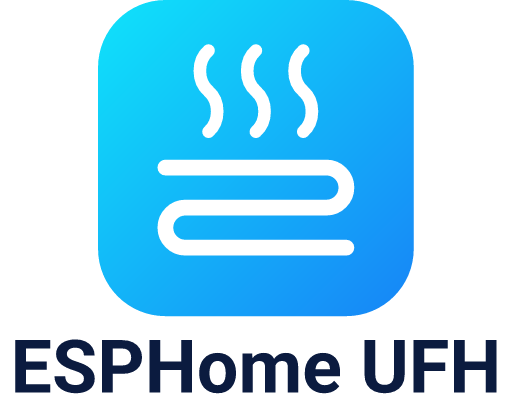

  <picture>
    <source media="(prefers-color-scheme: dark)" srcset="docs/img/logo-dark.png">
    <source media="(prefers-color-scheme: light)" srcset="docs/img/logo-light.png">
    
  </picture>

<b>Like it? Help me build something better.</b> 
  
  

  
  
  
  

<b>Your underfloor heating in Home Assistant. Zones, pump and heat demand, over a network cable. No YAML, no cloud.</b> 
🇵🇹 <a href="README.pt.md">Ler em português</a>

  

## Compatibility

**M5Stack Unit PoE-P4** (Ethernet + PoE, in its own case) with:
- **relays straight on the ESP pins** — up to 13 (3.3 V input boards, e.g. the Denkovi relay board of a DAEnetIP4), or
- **MCP23017** + any 16-channel relay board — up to 16.

Details: [what you need](docs/getting-started.md) · [wiring](docs/wiring.md)

## Install in 3 steps

1. **Flash** — Open the **[web installer](https://skydoy.github.io/ESPHome_UFH/)**, pick the board, plug it in by USB-C → **Install**.
2. **Connect** — network cable (PoE, or 5 V on USB-C) and the relays ([wiring](docs/wiring.md)).
3. **Set up** — open `http://<device-ip>/` and follow the **wizard** (zones, sensors, schedules). Home Assistant is optional.

## What you get

- **Thermostats on the device**: Comfort / Eco schedules, works without Home Assistant
- Sensors per zone: **Shelly H&T** (Wi-Fi), **MQTT**, **Home Assistant** or **DS18B20**
- **Pump** with delays and **heat demand** for the heat pump / boiler
- **Live diagram** on the web page, setup wizard, schedule editor, zone balance
- Optional: open window, optimum start, solar surplus, two-rate tariff, anti-seize, floor limit, ESPHome_Altherma link
- One-click firmware updates (or automatic at night)

## Docs & more

[Documentation site](https://skydoy.github.io/ESPHome_UFH/docs/) ·
[Configuration](docs/configuration.md) ·
[Home Assistant](docs/home-assistant.md) ·
[Troubleshooting](docs/troubleshooting.md) ·
[Security](docs/security.md) ·
[Changelog](CHANGELOG.md) ·
[Report a problem](https://github.com/skydoy/ESPHome_UFH/issues)

> ⚠️ Actuators, pumps and boilers run on 230 V: leave the mains side to a qualified electrician.

[PolyForm Noncommercial 1.0.0](LICENSE) — free for personal and non-commercial use; commercial use not permitted.  
[Security policy](SECURITY.md) · [Third-party notices](THIRD_PARTY_NOTICES.md)
