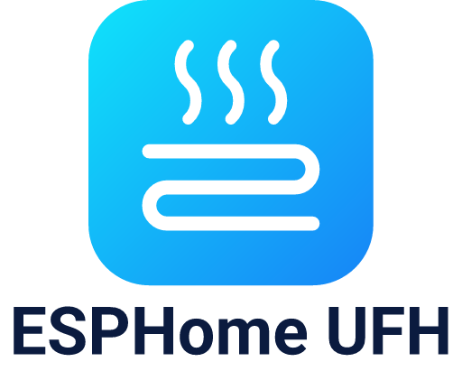

  <picture>
    <source media="(prefers-color-scheme: dark)" srcset="docs/img/logo-dark.png">
    <source media="(prefers-color-scheme: light)" srcset="docs/img/logo-light.png">
    
  </picture>

<b>Gostas? Ajuda-me a fazer algo ainda melhor.</b> 
  
  

  
  
  
  

<b>O teu piso radiante no Home Assistant. Zonas, bomba e pedido de calor, por cabo de rede. Sem YAML, sem nuvem.</b> 
🇬🇧 <a href="README.md">Read in English</a>

  

## Compatibilidade

**M5Stack Unit PoE-P4** (Ethernet + PoE, já vem em caixa) com:
- **relés diretamente nos pinos do ESP** — até 13 (placas com entradas de 3,3 V, por exemplo a placa de relés Denkovi de um DAEnetIP4), ou
- **MCP23017** + qualquer placa de 16 relés — até 16.

Detalhes: [o que precisas](docs/getting-started.pt.md) · [ligações](docs/wiring.pt.md)

## Instalar em 3 passos

1. **Instalar o firmware** — Abre o **[instalador web](https://skydoy.github.io/ESPHome_UFH/)**, escolhe **UFH zonas** ou **UFH tanque**, liga-a por USB-C → **Instalar**.
2. **Ligar** — cabo de rede (PoE, ou 5 V no USB-C) e os relés ([ligações](docs/wiring.pt.md)).
3. **Configurar** — abre `http://<ip-da-placa>/` e segue o **assistente** (zonas, sensores, horários). O Home Assistant é opcional.

## O que tens

- **Termóstatos na própria placa**: Conforto / Eco por horário, funciona sem Home Assistant
- Sensores à escolha por zona: **Shelly H&T** (Wi-Fi), **MQTT**, **Home Assistant** ou **DS18B20**
- **Bomba** com atrasos e **pedido de calor** à bomba de calor / caldeira
- **Diagrama em tempo real** na página web, assistente, editor de horários, equilíbrio das zonas
- Opcionais: janela aberta, arranque antecipado, excedente solar, tarifa bi-horária, anti-bloqueio, limite do pavimento, ligação ao ESPHome_Altherma, segunda placa para o [tanque de inércia](docs/tank.pt.md)
- Atualizações com um clique (ou automáticas à noite)

## Documentação e mais

[Site de documentação](https://skydoy.github.io/ESPHome_UFH/docs/pt/) ·
[Configuração](docs/configuration.pt.md) ·
[Home Assistant](docs/home-assistant.pt.md) ·
[Problemas](docs/troubleshooting.pt.md) ·
[Segurança](docs/security.pt.md) ·
[Changelog](CHANGELOG.md) ·
[Reportar um problema](https://github.com/skydoy/ESPHome_UFH/issues)

> ⚠️ Atuadores, bombas e caldeiras funcionam a 230 V: a parte de alta tensão é para um eletricista.

[PolyForm Noncommercial 1.0.0](LICENSE) — grátis para uso pessoal e não comercial; o uso comercial não é permitido.  
[Política de segurança](SECURITY.md) · [Avisos de terceiros](THIRD_PARTY_NOTICES.md)
