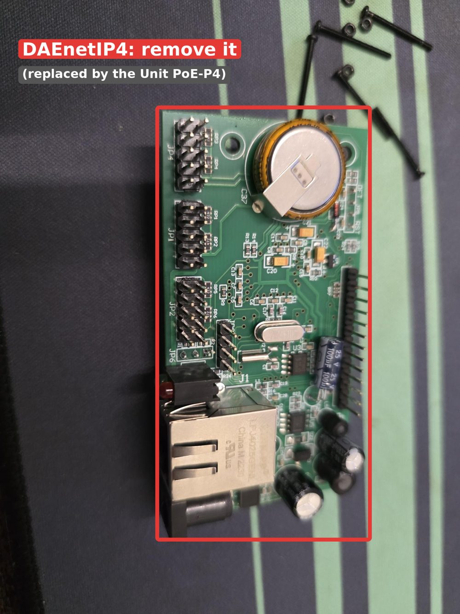
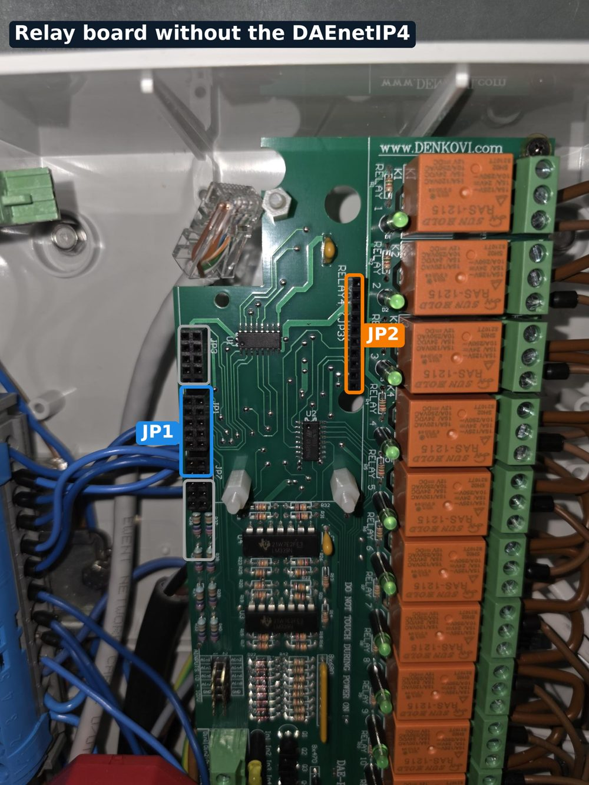
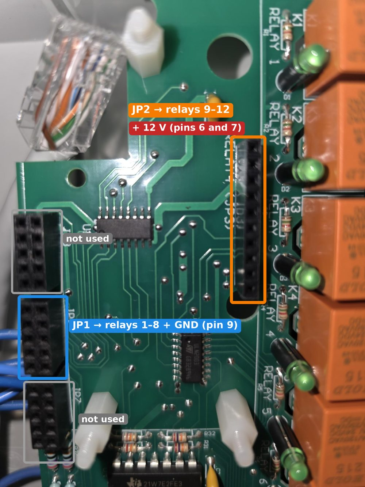
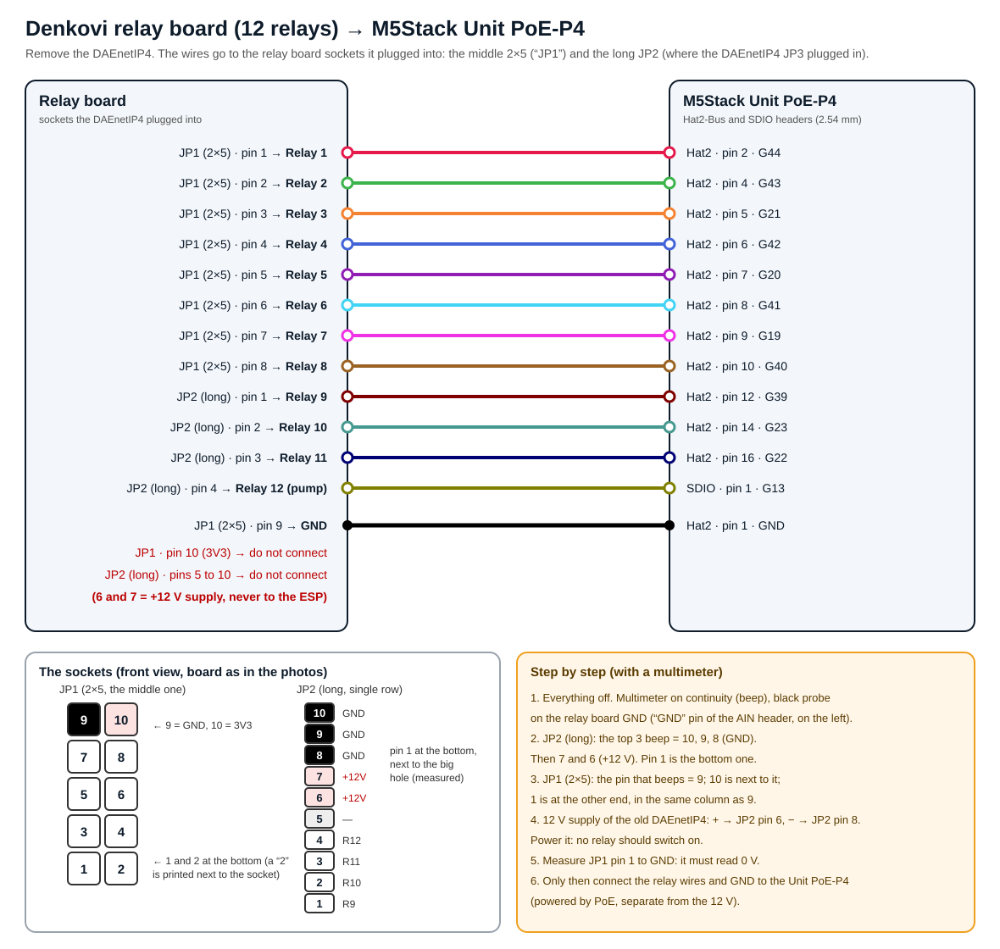

# Replacing the DAEnetIP4 (Denkovi 12 relays)

Step-by-step guide for a **Denkovi 12-relay board** (DAE-PB/Ro12/Di8/Ai8) driven by a **DAEnetIP4**, moving to ESPHome UFH with an **M5Stack Unit PoE-P4**. The relay board, the 230 V wiring and the relay numbers stay the same: only the "brain" changes.

!!! danger "Mains voltage"
    The relays switch actuators and pumps at **230 V**. Turn the breaker off before working in the panel.

## What you need

- M5Stack Unit PoE-P4 with the **ESPHome UFH — relays on the ESP pins** firmware ([install](install.md)).
- 13 **female-female** Dupont wires (12 relays + GND) and 2 for the 12 V supply.
- A **female DC jack to screw terminal** adapter (for the 12 V supply that powered the DAEnetIP4).
- A multimeter.

## 1. Remove the DAEnetIP4

{ width="420" }

Unscrew and remove the small board (DAEnetIP4). It is no longer used.

## 2. Find the relay board sockets

{ width="420" }
{ width="420" }

| Relay board socket | Was DAEnetIP4 | Used for |
|---|---|---|
| **JP1** (2×5, the middle one) | JP1 | relays 1–8 (pins 1–8) and **GND** (pin 9) |
| **JP2** (long, single row) | JP3 | relays 9–12 (pins 1–4) and **12 V supply** (pins 6–7 = +, 8–10 = −) |
| The other two 2×5 | JP4 / JP2 | not used (analog and digital inputs) |

## 3. Wiring diagram

!!! warning "JP2 pins 6 and 7 carry +12 V"
    Never connect them to the Unit PoE-P4. Connect **only pins 1–4** of JP2 to the ESP. The 12 V go from the supply to pins 6 (+) and 8 (−).

## 4. Step by step with a multimeter

1. Everything off. Multimeter on continuity (beep), black probe on the relay board **GND** ("GND" pin of the AIN header, on the left).
2. **JP2**: the 3 pins in a row that beep are **8, 9 and 10**. The next 2 are **7 and 6** (+12 V). The one at the other end is **pin 1**.
3. **JP1**: the pin that beeps is **9**; **10** is next to it; **1** is at the other end, in the same column as 9 (by the printed "2", 1 and 2 are at the bottom).
4. Connect the 12 V supply: **+ → JP2 pin 6**, **− → JP2 pin 8**. No relay should switch on.
5. Measure **JP1 pin 1** to GND: it must read **0 V**.
6. Only then connect the relay wires and GND to the Unit PoE-P4, as in the diagram. The Unit PoE-P4 is powered by PoE, separate from the 12 V; the only shared wire is GND.

## 5. Setup wizard

On the device page (http://device-ip/) → **Settings**:

- **Relays switch on with HIGH** (DAEnetIP4 outputs were 0 / 3.3 V and the relays are driven by ULN2003 chips).
- Number of zones (e.g. 11) and relay 12 function: **pump / heat pump**.
- Relay 13 (SDIO pin 2) stays free.

!!! note "Inputs In1…In8"
    The relay board also has 8 digital inputs (In1…In8) and 8 analog inputs. ESPHome UFH does not use them: temperatures come from the sensors (Shelly H&T, Home Assistant, MQTT, DS18B20).
