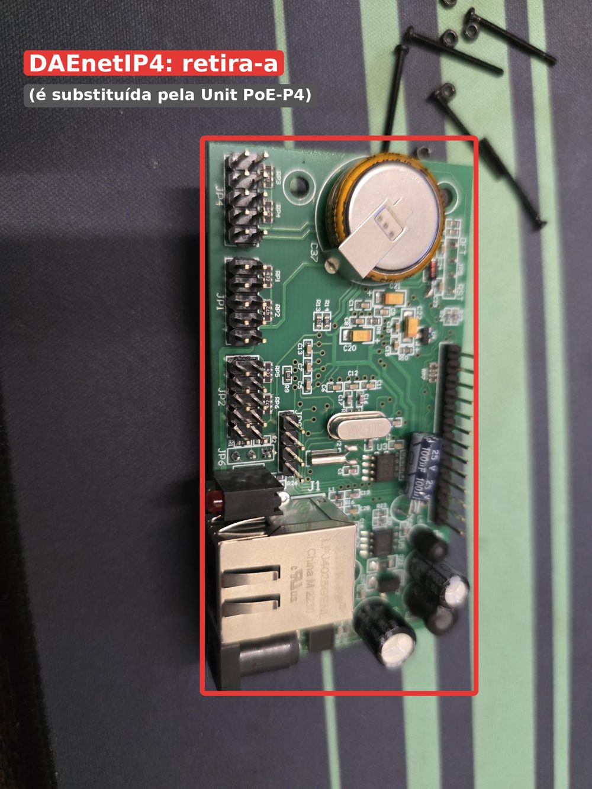
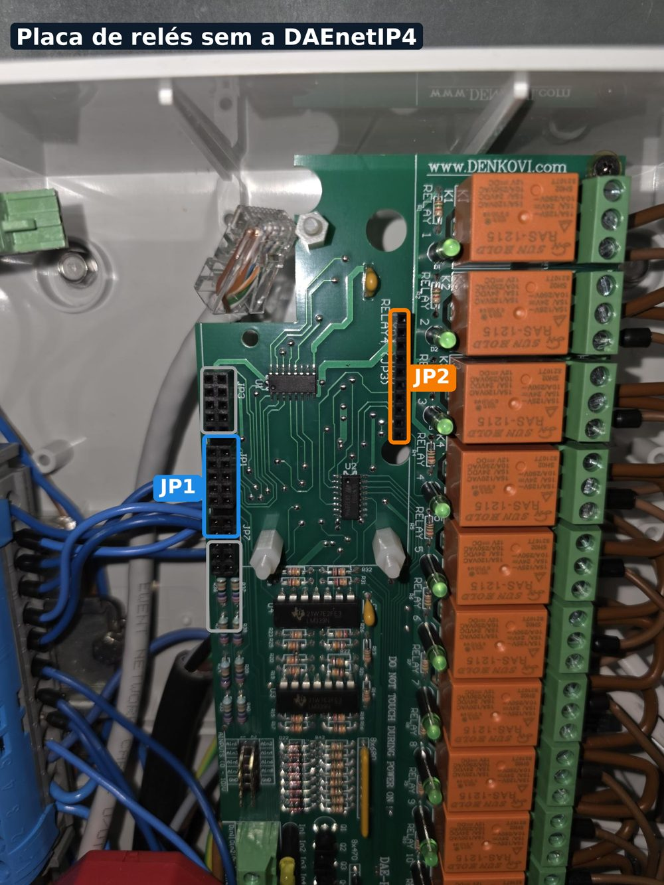
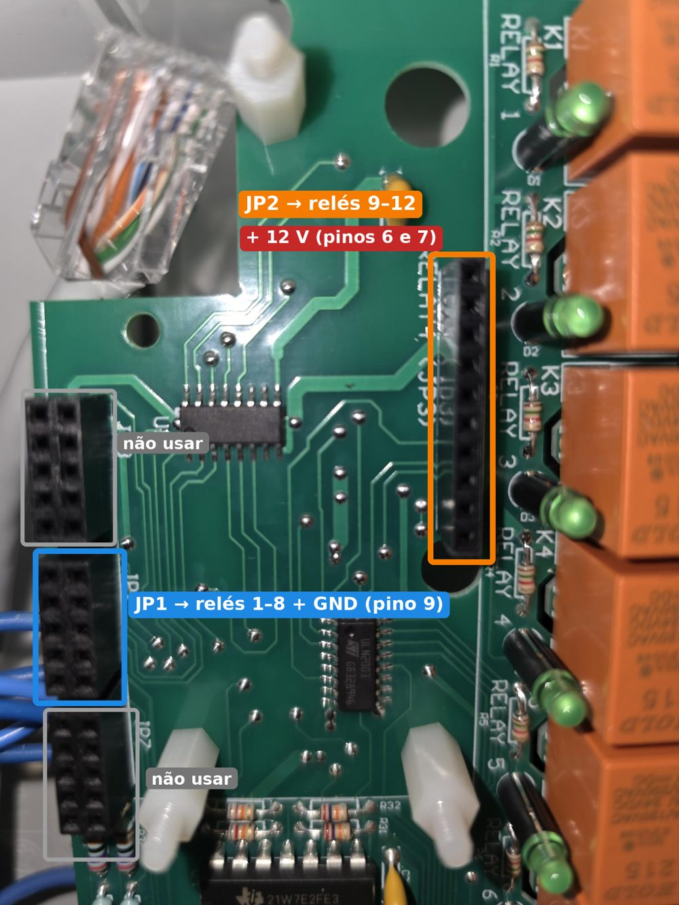
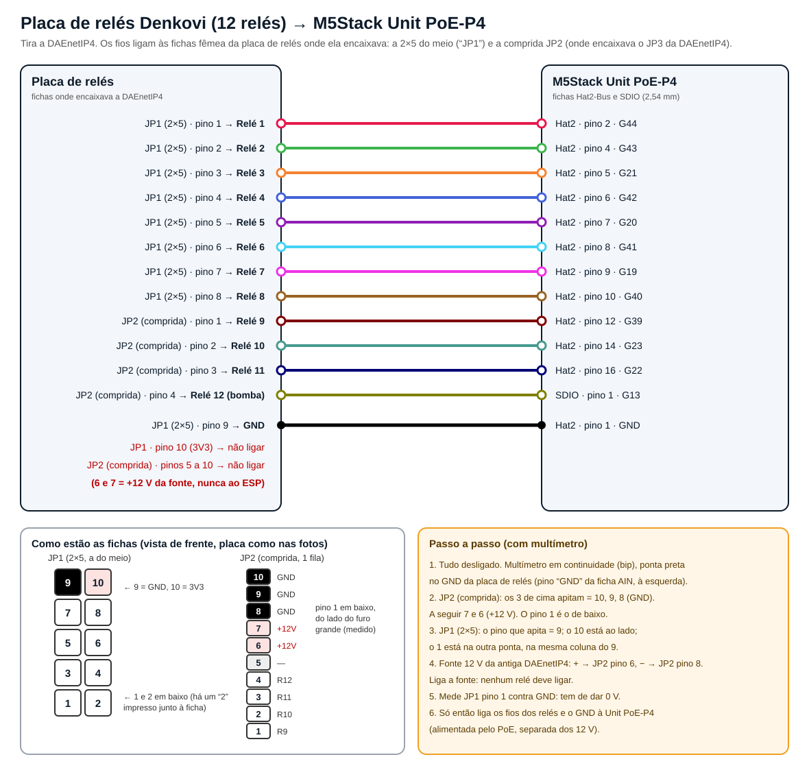

# Trocar a DAEnetIP4 (Denkovi 12 relés)

Guia passo a passo para quem tem uma **placa de relés Denkovi de 12 relés** (DAE-PB/Ro12/Di8/Ai8) comandada por uma **DAEnetIP4** e a quer passar para o ESPHome UFH com uma **M5Stack Unit PoE-P4**. A placa de relés, as ligações de 230 V e a numeração dos relés ficam iguais: só se troca o "cérebro".

!!! danger "Tensão da rede"
    Os relés comandam atuadores e bombas a **230 V**. Desliga o disjuntor antes de mexer no quadro.

## O que precisas

- M5Stack Unit PoE-P4 com o firmware **ESPHome UFH — relés nos pinos do ESP** ([instalar](install.md)).
- 13 fios Dupont **fêmea-fêmea** (12 relés + GND) e 2 para a alimentação de 12 V.
- Um adaptador de **jack fêmea para bornes** (para a fonte de 12 V que alimentava a DAEnetIP4).
- Um multímetro.

## 1. Tira a DAEnetIP4

{ width="420" }

Desaperta e retira a placa pequena (DAEnetIP4). Deixa de ser usada.

## 2. Identifica as fichas da placa de relés

{ width="420" }
{ width="420" }

| Ficha da placa de relés | Era do DAEnetIP4 | Usa-se para |
|---|---|---|
| **JP1** (2×5, a do meio) | JP1 | relés 1–8 (pinos 1–8) e **GND** (pino 9) |
| **JP2** (comprida, 1 fila) | JP3 | relés 9–12 (pinos 1–4) e **alimentação 12 V** (pinos 6–7 = +, 8–10 = −) |
| As outras duas 2×5 | JP4 / JP2 | não se usam (entradas analógicas e digitais) |

## 3. Esquema de ligações

!!! warning "Os pinos 6 e 7 da JP2 têm +12 V"
    Nunca os ligues à Unit PoE-P4. Liga **só os pinos 1–4** da JP2 ao ESP. Os 12 V vão da fonte para os pinos 6 (+) e 8 (−).

## 4. Passo a passo com o multímetro

1. Tudo desligado. Multímetro em continuidade (bip), ponta preta no **GND** da placa de relés (pino "GND" da ficha AIN, à esquerda).
2. **JP2**: os 3 pinos seguidos que apitam são o **8, 9 e 10**. Os 2 a seguir são o **7 e 6** (+12 V). O da outra ponta é o **pino 1**.
3. **JP1**: o pino que apita é o **9**; o **10** está ao lado; o **1** está na outra ponta, na mesma coluna do 9 (pela marca "2" impressa, 1 e 2 ficam em baixo).
4. Liga a fonte de 12 V: **+ → JP2 pino 6**, **− → JP2 pino 8**. Nenhum relé deve ligar.
5. Mede **JP1 pino 1** contra o GND: tem de dar **0 V**.
6. Só então liga os fios dos relés e o GND à Unit PoE-P4, como no esquema. A Unit PoE-P4 é alimentada pelo PoE, separada dos 12 V; o único fio em comum é o GND.

## 5. Assistente da placa

Na página da placa (http://IP-da-placa/) → **Definições**:

- **Relés ligam com sinal ALTO** (as saídas da DAEnetIP4 eram de 0 / 3,3 V e os relés são comandados por ULN2003).
- Número de zonas (ex.: 11) e a função do relé 12: **bomba / bomba de calor**.
- O relé 13 (SDIO pino 2) fica livre.

!!! note "Entradas In1…In8"
    A placa de relés também tem 8 entradas digitais (In1…In8) e 8 analógicas. O ESPHome UFH não as usa: as temperaturas vêm dos sensores (Shelly H&T, Home Assistant, MQTT, DS18B20).
