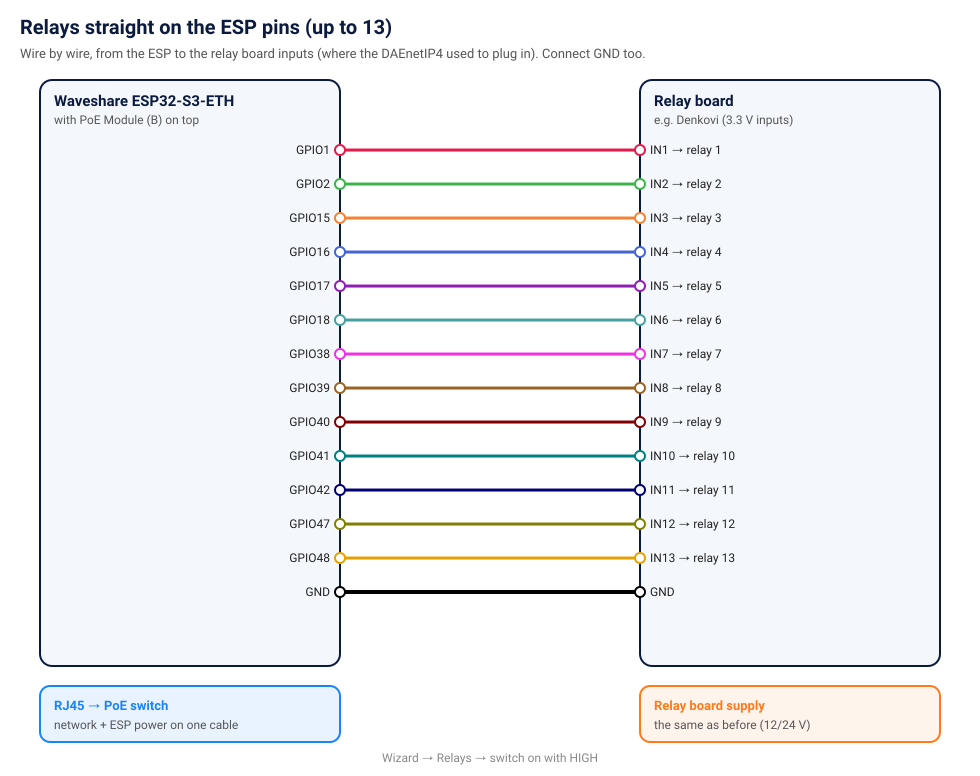
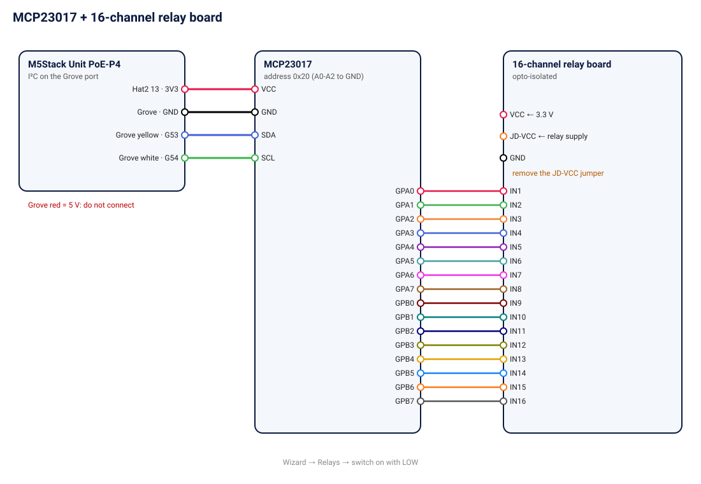
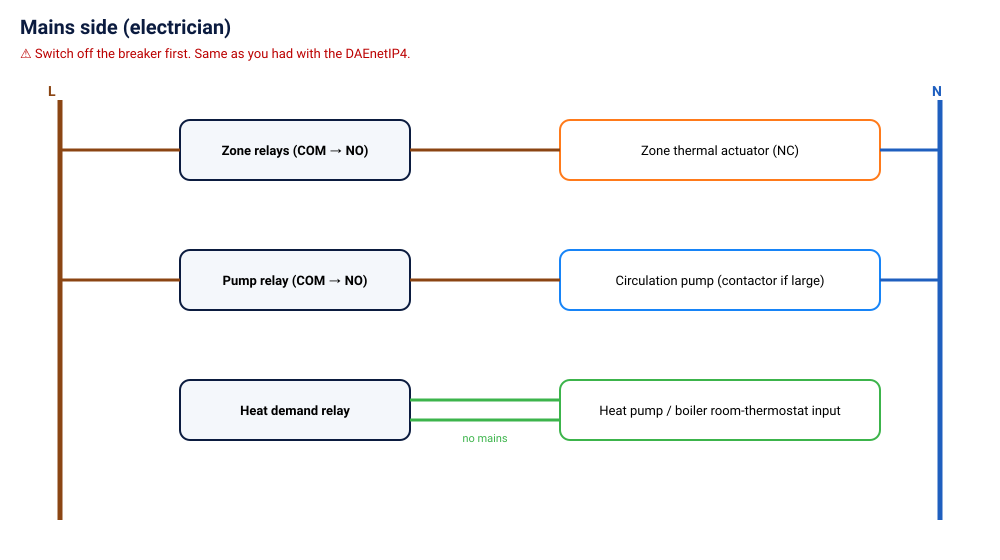

# Wiring

!!! danger "Mains voltage"
    Thermal actuators, pumps and boiler controls usually run on **230 V**. Switch off the breaker and leave the mains side to a qualified electrician.

## Option A — relays on the ESP pins (up to 13)

For relay boards whose inputs work with **3.3 V** logic, such as the Denkovi boards driven by a DAEnetIP4 (its outputs were 0 / 3.3 V). The ESP replaces the DAEnetIP4: the relay board, the 230 V wiring and the numbering stay. Have a Denkovi 12-relay board? Follow the [photo guide](denkovi.md).

| Relay | 1 | 2 | 3 | 4 | 5 | 6 | 7 | 8 | 9 | 10 | 11 | 12 | 13 |
|---|---|---|---|---|---|---|---|---|---|---|---|---|---|
| ESP GPIO | 44 | 43 | 21 | 42 | 20 | 41 | 19 | 40 | 39 | 23 | 22 | 13 | 12 |
| Header · pin | Hat2 · 2 | Hat2 · 4 | Hat2 · 5 | Hat2 · 6 | Hat2 · 7 | Hat2 · 8 | Hat2 · 9 | Hat2 · 10 | Hat2 · 12 | Hat2 · 14 | Hat2 · 16 | SDIO · 1 | SDIO · 2 |

Relays 1–11 go to the **Hat2-Bus** header (16 pins) and 12–13 to the **SDIO** header (9 pins), both 2.54 mm, so female Dupont wires fit. Also connect **GND** (Hat2-Bus pin 1) to GND of the relay board. In the wizard choose **relays switch on with HIGH**.
A 1-Wire bus for DS18B20 probes is on **GPIO11** (SDIO pin 3, 4.7 kΩ pull-up to 3.3 V on Hat2-Bus pin 13). The optional buffer-tank probe uses this same bus. On a 16-relay MCP23017 board, typical roles are zones 1–11, heat demand on 12, tank pump on 13, emergency heater on 14. A mechanical thermostat **in series** with the heater is required; there is no mixing valve, so tank water goes to the screed. See [Buffer tank](tank.md).

!!! warning "Before connecting"
    With the ESP disconnected and the relay board powered, measure between one IN input and GND of the relay board: it must read **0 V or at most 3.3 V**. If it reads 5 V or 12 V, do not connect it directly: use option B (MCP23017).

## Option B — MCP23017 + 16-channel relay board

| Unit PoE-P4 | MCP23017 |
|---|---|
| 3V3 (Hat2-Bus pin 13) / GND | VCC / GND |
| Grove yellow G53 / white G54 | SDA / SCL |

The red Grove wire is **5 V**: do not connect it to the MCP23017, power it from 3.3 V on the Hat2-Bus.

MCP23017 A0-A2 to GND (address `0x20`). **GPA0…GPB7 = relays 1…16.** On opto-isolated boards remove the **JD-VCC** jumper, feed **VCC** from 3.3 V and **JD-VCC** from the relay supply; choose **LOW** in the wizard. DS18B20 bus: **GPIO11** (SDIO pin 3).

## Relays after the zones

| Function (wizard) | Connect |
|---|---|
| Circulation pump | pump (through a contactor if it draws more than the relay rating) |
| Heat demand | heat pump / boiler **room thermostat input** (dry contact) |
| Pump + heat demand | one relay for both |

Power: PoE (up to 6 W) powers the Unit PoE-P4 only. The relay board keeps its own supply.
