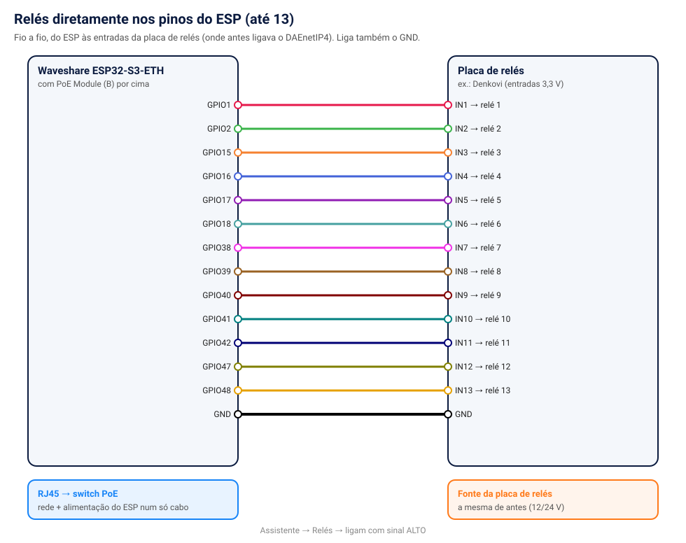
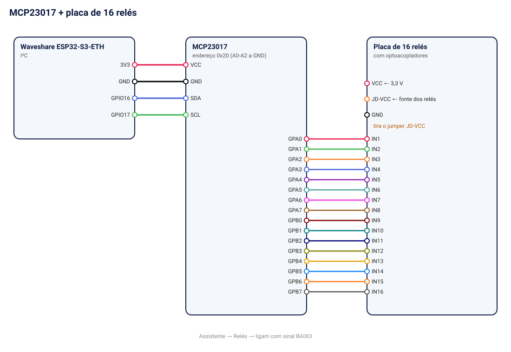
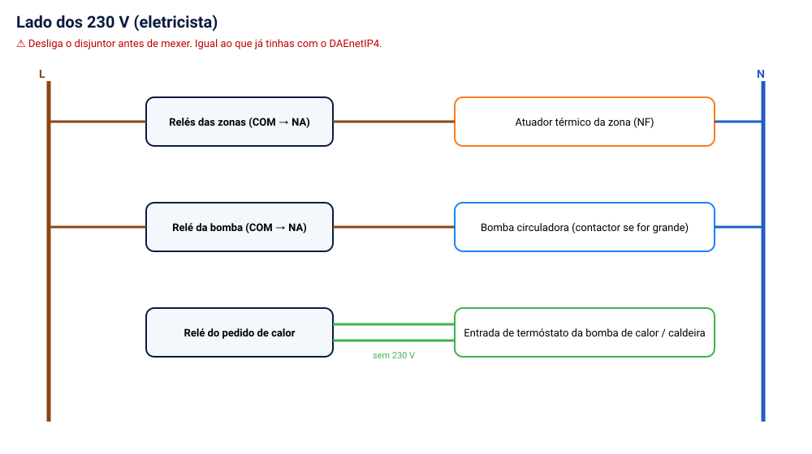

# Ligações

!!! danger "Tensão da rede"
    Atuadores térmicos, bombas e comandos de caldeira funcionam a **230 V**. Desliga o disjuntor e deixa a parte de 230 V para um eletricista.

## Opção A — relés nos pinos do ESP (até 13)

Para placas de relés com entradas de **3,3 V**, como as Denkovi comandadas por um DAEnetIP4 (as saídas dele eram de 0 / 3,3 V). Tens uma Denkovi de 12 relés? Segue o [guia com fotos](denkovi.md). O ESP substitui o DAEnetIP4: a placa de relés, as ligações de 230 V e a numeração ficam iguais.

| Relé | 1 | 2 | 3 | 4 | 5 | 6 | 7 | 8 | 9 | 10 | 11 | 12 | 13 |
|---|---|---|---|---|---|---|---|---|---|---|---|---|---|
| GPIO do ESP | 44 | 43 | 21 | 42 | 20 | 41 | 19 | 40 | 39 | 23 | 22 | 13 | 12 |
| Ficha · pino | Hat2 · 2 | Hat2 · 4 | Hat2 · 5 | Hat2 · 6 | Hat2 · 7 | Hat2 · 8 | Hat2 · 9 | Hat2 · 10 | Hat2 · 12 | Hat2 · 14 | Hat2 · 16 | SDIO · 1 | SDIO · 2 |

Os relés 1–11 ligam à ficha **Hat2-Bus** (16 pinos) e os 12–13 à ficha **SDIO** (9 pinos), ambas de 2,54 mm, por isso servem cabos Dupont fêmea. Liga também o **GND** (Hat2-Bus pino 1) ao GND da placa de relés. No assistente escolhe **relés ligam com sinal ALTO**.
O barramento 1-Wire para sondas DS18B20 fica no **GPIO11** (SDIO pino 3, resistência de 4,7 kΩ para os 3,3 V do Hat2-Bus pino 13).

!!! warning "Antes de ligar"
    Com o ESP desligado e a fonte da placa de relés ligada, mede a tensão entre uma entrada IN e o GND da placa de relés: tem de dar **0 V ou no máximo 3,3 V**. Se der 5 V ou 12 V, não ligues diretamente: usa a opção B (MCP23017).

## Opção B — MCP23017 + placa de 16 relés

| Unit PoE-P4 | MCP23017 |
|---|---|
| 3V3 (Hat2-Bus pino 13) / GND | VCC / GND |
| Grove amarelo G53 / branco G54 | SDA / SCL |

O fio vermelho da Grove tem **5 V**: não o ligues ao MCP23017, alimenta-o com os 3,3 V do Hat2-Bus.

A0-A2 do MCP23017 a GND (endereço `0x20`). **GPA0…GPB7 = relés 1…16.** Nas placas com optoacoplador tira o jumper **JD-VCC**, alimenta o **VCC** com 3,3 V e o **JD-VCC** com a fonte dos relés; no assistente escolhe **BAIXO**. Barramento DS18B20: **GPIO11** (SDIO pino 3).

## Relés a seguir às zonas

| Função (assistente) | Liga |
|---|---|
| Bomba circuladora | bomba (com contactor se puxar mais do que o relé aguenta) |
| Pedido de calor | **entrada de termóstato ambiente** da bomba de calor / caldeira (contacto seco) |
| Bomba + pedido de calor | um só relé para as duas |

Alimentação: o PoE (até 6 W) alimenta só a Unit PoE-P4. A placa de relés continua com a fonte dela.
